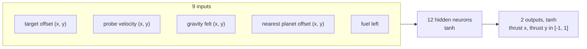

# 3. A neural network from scratch

*Code: [`nn/mlp.py`](../../nn/mlp.py), [`env/agent.py`](../../env/agent.py),
[`env/navigation.py`](../../env/navigation.py) (`observe`).*

The "pilot" is a **multilayer perceptron** small enough to write out by
hand: 9 inputs, 12 hidden neurons, 2 outputs.

Each hidden neuron computes a weighted sum of the inputs plus a bias,
then squashes it with $\tanh$, which maps any number into (−1, 1). The
outputs do the same, and the result is read as a thrust direction and
strength. That's the whole brain:

$$\mathbf{h} = \tanh(W_1\mathbf{x} + \mathbf{b}_1), \qquad \text{thrust} = \tanh(W_2\mathbf{h} + \mathbf{b}_2)$$

Counting the numbers: $9 \times 12 + 12 + 12 \times 2 + 2 = 146$. Those
146 floats, laid end to end, are the agent's **genome**. Evolution
(page 4) only ever sees that flat list; `MLP(sizes, genome)` turns it
back into a network.

## Choosing what it can see

The inputs are the design decision that matters most, and each one is
scaled to roughly ±1 so no input drowns out the others:

- **Target offset** and **velocity**: enough to fly in empty space. A
  hand-written controller using only these (thrust toward the target,
  minus a bit of current velocity) scores 1.047 in free space; the
  evolved net beats it at 1.080.
- **Gravity felt**: unbounded near a planet, so it's squashed with
  $g / (|g| + 1)$ to keep it in (−1, 1).
- **Nearest planet offset**: deliberately *planet*, not *body*. Near
  the start the star is always the nearest body, so "nearest body" told
  the agent nothing useful about where a flyby could come from.
- **Fuel left**, as a fraction.

One experiment that didn't help: adding the nearest planet's *relative
velocity* (11 inputs). On paper it's what you'd need to time a flyby;
in practice scores didn't improve, so it was reverted (see the README's
experiment table).

## Why so small?

Because it has to run on a phone, in pure Python, inside an x86
emulator. One forward pass is about 150 multiply–adds, and a training
run evaluates the network hundreds of thousands of times. It also keeps
the search space small enough for evolution, which gets slower as the
genome grows.

The network has **no memory**: it sees the present and reacts. Whatever
looks like planning in its flights (a waiting coast before a burn, a
loop round the star) comes from reacting to a changing view.

**Next:** [4. Learning by evolution](4-neuroevolution.md).
