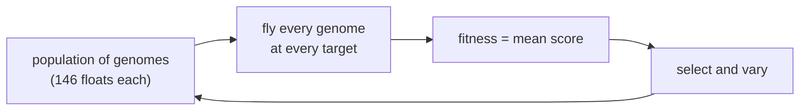

# 4. Learning by evolution

*Code: [`evolve/strategies.py`](../../evolve/strategies.py),
[`env/training.py`](../../env/training.py),
[`npbackend/batch.py`](../../npbackend/batch.py). Try:
`python3 -m cli.train --task free --generations 30`.*

There are no gradients and no backpropagation here. The network is
improved the way breeders improve plants: try many variants, keep the
best, vary them, repeat.

## The loop

A genome's **fitness** is its average score over a fixed set of targets.
Scoring an episode:

| Outcome | Score |
|---|---|
| reached the target | 1 + up to 0.5 for arriving early |
| missed | up to 0.8 for how close it got |
| always | minus a fuel penalty (up to `fuel_weight`) |
| crashed into a body | −0.5 more |

## Two strategies

**Genetic algorithm (GA).** Rank the population. The top quarter breed:
each child takes each weight from one of two parents at random
(crossover), then every weight gets a little Gaussian noise (mutation).
The very best few (the *elite*) survive unchanged, so the best score
can never go down.

**Evolution strategy (ES).** Keep one "mean" genome. Each generation,
try it with many random nudges, in pairs ($+\varepsilon$ and
$-\varepsilon$, which cancels a lot of noise). Rank the results and move
the mean toward the nudges that ranked well. It approximates a gradient
by sampling, without ever differentiating anything.

Both draw every random number from their own seeded generator, so a
training run is exactly reproducible: re-running the golden free-space
agent's training produced the same 146 weights, bit for bit.

## What happened

| Task | Strategy | Generations × population | Result |
|---|---|---|---|
| free space, 12 targets | ES | 100 × 32 | 1.080, every target reached, held-out targets too |
| three-body field, 24 targets | ES | 500 × 64 | 19/24 reached, 7/12 never-seen targets |
| low fuel (assist) | ES | 100 × 32 | 3/6 reached, one using a gravity assist |

## Where evolution gets stuck

**Memorising instead of learning.** Trained on 6 targets in the field,
an agent reached 5 of them and only 1 in 6 new ones: it had learned six
routes, not how to steer. Training on 24 targets fixed most of that
(7/12 held-out). The same thing happened with the rendezvous mission.
More varied training cases is the cheapest cure.

**The "do nothing" trap.** On the low-fuel task, thrusting costs fuel
score immediately, while reaching the target needs a long, precise
sequence of burns. A genome that never fires scores a safe 0.191, and
every small mutation away from it scores worse. GA runs collapsed into
that hole every time (exactly 0.191); ES's averaged nudges sometimes
escape it. The README lists what else was tried.

**Seeds matter.** Four seeds of the same free-space setup ended between
0.90 and 1.08. Reporting the best of several seeds is fine as long as
you say so, which the README does.

## Speed: the numpy backend

Training is almost all evaluation: 64 genomes × 24 targets × 320 steps
is half a million physics steps per generation. In pure Python that's
seconds per generation. The optional numpy backend runs every
(genome, target) episode in lockstep as rows of arrays, 12–21× faster,
and gives the same scores (to 10⁻¹² in free space). The core never
imports numpy, so everything still runs on iSH without it.

**Next:** [5. Gravity assists](5-gravity-assists.md).
