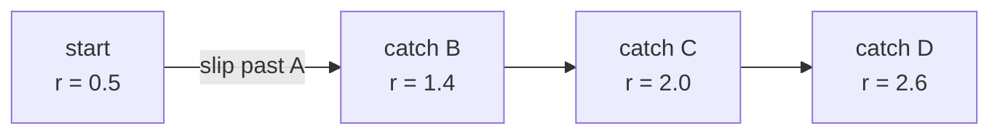

# 7. The grand tour: multi-body traversal

*Code: [`env/navigation.py`](../../env/navigation.py) (`Tour`, `TOUR`,
`grand_field`). Watch: `python3 -m cli.replay --task tour --target 9`.*

Every earlier mission had one target. The grand tour asks for a
sequence: start deep inside a system of **a star and four planets**,
get past the innermost planet, then catch three more **in order**:

| Body | Orbit radius | Mass | Role |
|---|---|---|---|
| star | centre | 1 | felt everywhere |
| A | 0.9 | 0.03 | hazard: easy to hit, easy to catch by accident |
| B | 1.4 | 0.04 | stop 1 |
| C | 2.0 | 0.05 | stop 2 |
| D | 2.6 | 0.02 | stop 3 |

## Why it's much harder than one target

**The target changes mid-flight.** The network has no memory, so it
can't "remember" that it has finished stop 1. Instead the observation
switches: the moment B is caught, the "target offset" inputs start
pointing at C. The same 146 weights must handle every leg.

**Arriving is not enough.** Catching B leaves the probe moving with
whatever velocity it had at B. If that's wrong for the climb to C, the
next leg starts badly. Good tours shape each leg for the next one,
which a reactive network has to discover without being told.

**Four planets, four rhythms.** Their periods are about 5.4, 10.4, 17.8
and 26.3 time units, so the configuration never repeats. Each of the 36
launch delays meets a different arrangement.

**More chaos.** In the three-body field, a coasting probe's outcome was
stable against a 10⁻⁹ nudge for about 20 time units. In the five-body
field over 800 steps (20 time units), a **10⁻¹⁵** nudge changes the
outcome of 5 of 36 launches for a random network: one ends in a crash,
the other leaves the system. That's why tour parity between the numpy
and Python backends is checked on stop counts and medians, not exact
scores ([`env/test_tour.py`](../../env/test_tour.py)).

## Scoring a tour

Each planet caught is worth 1. Finishing the tour adds up to 0.5 for
arriving early; otherwise the current leg adds up to 0.8 for how close
the probe got to its stop, measured from where that leg began. Fuel and
crashes cost as before. A single target is just a one-stop tour under
the same formula, which is why every earlier golden agent re-scores
identically after tours were added.

## Learning in stages

A one-target task is learned more or less all at once. A tour can only
be learned **in order**: nothing about stop 2 can be rewarded until some
genome catches stop 1. So evolution should show *stages*: a long phase
where the population learns the first catch, then a second phase where
a few genomes start reaching the second planet, and so on. The
visual explainer's skill-stages chart records exactly that: every 10
generations, how many of the 64 genomes catch 0, 1, 2 or 3 planets.
