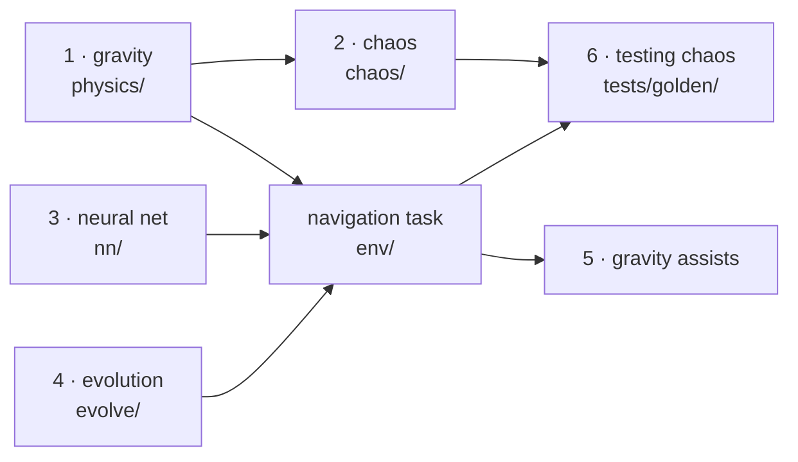

# Concepts behind slingshot

slingshot teaches a tiny neural network to fly a probe through a star
system, using nothing but evolution and Newton's law of gravity. Along
the way it touches five ideas that are each worth understanding on
their own. These pages explain them, using this project's own numbers
and pointing at the code that implements each one.

| Page | The question it answers |
|---|---|
| [1. Simulating gravity](1-gravity.md) | How do you move planets forward in time without them drifting off? |
| [2. Chaos](2-chaos.md) | Why can't you predict a three-body system, and how do you measure that? |
| [3. A neural network from scratch](3-neural-nets.md) | What is the "brain" here, and why is it only 146 numbers? |
| [4. Learning by evolution](4-neuroevolution.md) | How does it learn without gradients, and where does that get stuck? |
| [5. Gravity assists](5-gravity-assists.md) | How can a planet give a probe free energy, and how do we know the agent used one? |
| [6. Testing a chaotic system](6-testing-chaos.md) | How do you write reliable tests for something that amplifies rounding errors? |
| [7. The grand tour](7-grand-tour.md) | What changes when the probe must visit several moving planets in order? |

Read them in order if the ideas are new; each builds on the last. To
see them move, run the terminal demos:

```sh
python3 -m cli.chaos_demo bifurcation        # chaos, page 2
python3 -m cli.replay --task assist --target 5  # a gravity assist, page 5
python3 -m cli.train --generations 20        # evolution live, page 4
```


